# VLC redesign, based on Juxtopposed's concept

This branch implements the VLC redesign by **Juxtopposed**, presented in her
video **[I Redesigned VLC After 25 Years](https://youtu.be/ERFeOgqk324)** and
detailed in her Figma file *VLC Redesign (Community)*, in the VLC 4 (Qt/QML)
interface.

**All credit for the design goes to [Juxtopposed](https://juxtopposed.com).**
Go watch the video: it explains the reasoning behind every screen far better
than this page.

This is an unofficial, experimental fork. It is not affiliated with or endorsed
by Juxtopposed or by VideoLAN. The screenshots below were made with generated
test media.

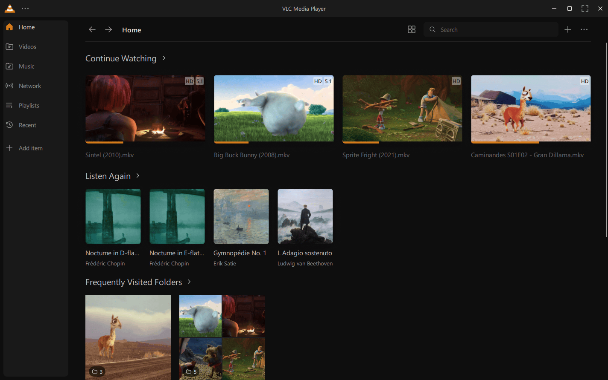

## The library

- A rounded navigation panel: Home, Videos, Music, Network, Playlists, Recent
  and "Add item" (a folder, a network stream or a new playlist). Any folder,
  playlist or album can be pinned there ("..." > Pin to Sidebar).
- **Home**: Continue Watching, Listen Again (title and artist), Frequently
  Visited Folders, then the newest videos and music.
- **Videos are the folders on the disk**: *Videos › Shows › The Wand › S01*,
  each part of the path a step back. A folder holding a single folder is
  skipped. All the videos, as one list, are in the "..." menu of the header.
- A header with back/forward, the path, the item count, sorting (including
  *Unwatched First* and *Watched First*), the grid/list switch, search, "+" and
  "...".
- **Grid** cards show the file name only; what was watched is dimmed, with its
  progress as an accent line under the picture, and what plays is in the
  accent color.
- **List** view: the compact list of the design, in columns, with small
  pictures.
- **Mini player**: a card in a bottom corner with the video itself (or the
  cover), its progress (click or drag to seek, the time shows on hover), the
  file name, its folder (a click opens it in the library), and the queue under a
  button. Its controls fade in on hover; drag it to the other corner; double
  click the picture to go back to the player.
- **Right-click menus** in the style of the design, with its items: Play, Mark
  as Watched, Favorite, Stream, Convert, Add to Queue, Add to Playlist, Show in
  File Explorer, Go to Source, Add Subtitle Tracks, Properties & Metadata.

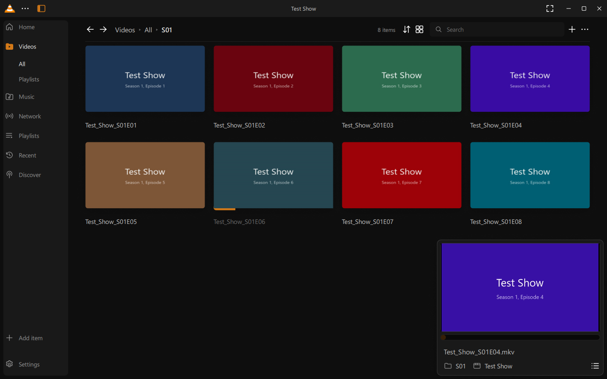
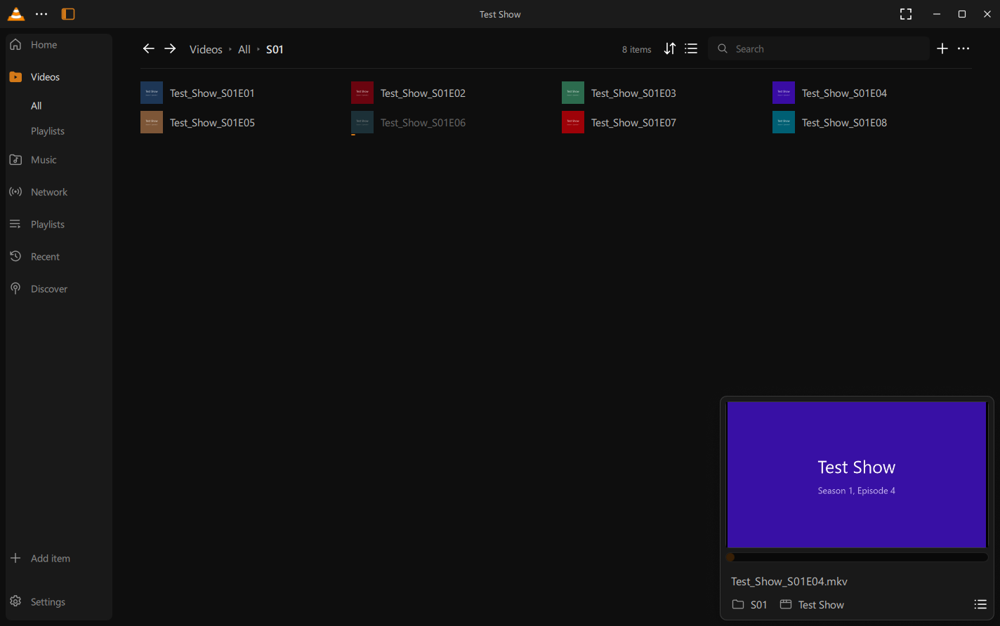
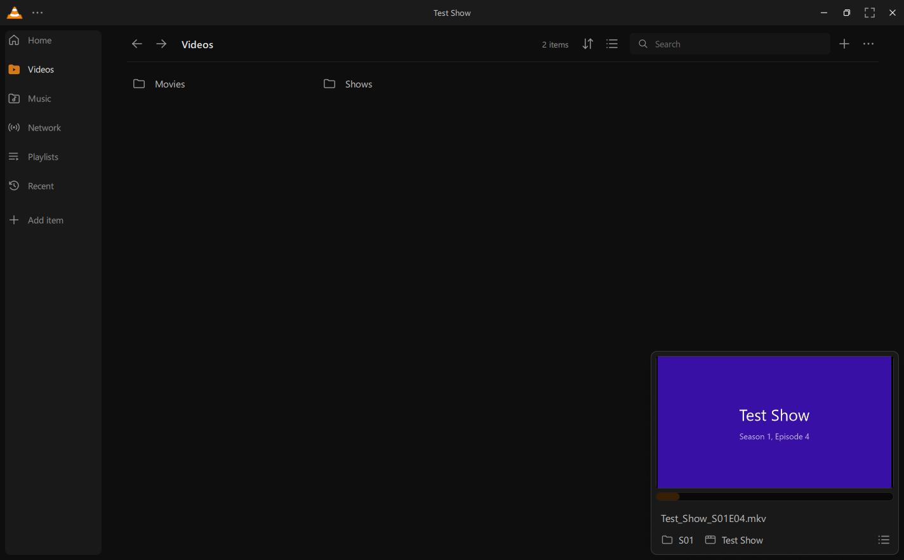
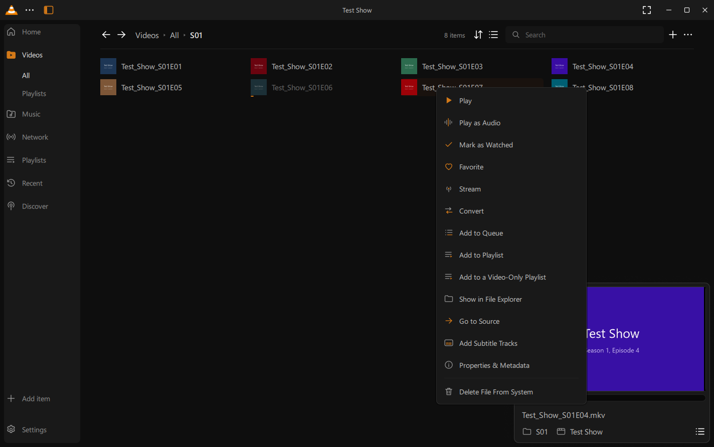

## The player

- **Title bar**: the "..." menu (open media, recent files, profiles, keyboard
  shortcuts, Customize Player, settings), the library, the folder of what plays
  (a click opens the library next to the video there), its name in the middle,
  and fullscreen next to the window buttons. In fullscreen it comes back with
  the control bar when the pointer goes near the top or the bottom. It is
  arranged in Customize Player like the control bar.
- **Control bar**: one thin row with previous/play/next, the time as
  `00:02:10`, a thick flat seek bar, the volume cone, audio, subtitles,
  settings and queue. Its icons light up on hover.
- **Seek preview**: hovering the seek bar shows the frame at that time, made in
  the background by VLC's thumbnailer.
- **Settings sidebar** with Playback, Video, Audio and Subtitles tabs: speed,
  sleep timer, audio visualizer; video filters, colors, crop and zoom; the equalizer
  with its curves, compressor, spatializer, stereo widener and an audio test;
  subtitle delay, speed, size, colors, outline and saved presets. It slides in
  from the right.
- **Show Waveform on Seekbar**, **Show Subtitle Timeline on Seekbar** and
  **Show Metadata**: the loudness of the audio along the seek bar, marks where
  the subtitle lines are (from a subtitle file or from the subtitle track inside
  the video), and the format, codecs and size of what plays over the video.
- **Subtitle timeline**: the subtitle lines as blocks along the seek bar.
  Press and hold the bar, then drag, to move the subtitles earlier or later:
  the bar zooms meanwhile on half a minute around what plays (the times on
  its sides showing where that window starts and ends) and zooms back out
  once released. It also zooms for a moment when the delay changes from the
  sidebar or the keyboard. A click still seeks; right click resets the
  delay.
- **Looks** in the Video tab: Vivid, Bright, Contrast, Muted, Black & White,
  Sepia, Old Movie and VHS, each shown on the picture that plays; a click
  applies the video filters, which can then be tuned below.
- **Queue**: a card on the right like the settings, with Queue, Bookmarks and
  Chapters tabs, and "+" to add files, a folder or a network stream. Ctrl+B
  adds a bookmark where the video is, without a dialog.
- **Library next to the video**: it slides over the video and opens on the
  folder of what plays (*... › The Wand › S01*), with a rail for Home, Videos
  (the folders again), Music (Songs as folders, Albums, Artists, Genres),
  Network, Playlists and Recent. Drag its files to the queue.
- **Continue watching**: for a video left halfway, "You've watched till
  00:12:34 already." with a Continue Watching button, above the control bar.
- The right-click menu of the video (its Open Media part also has Open from
  Clipboard, Stream and Convert), a click on the video to pause and a double
  click for fullscreen (both can be turned off in Settings), and *Hide UI*
  (`Ctrl+\`), which keeps only the video in the window frame.

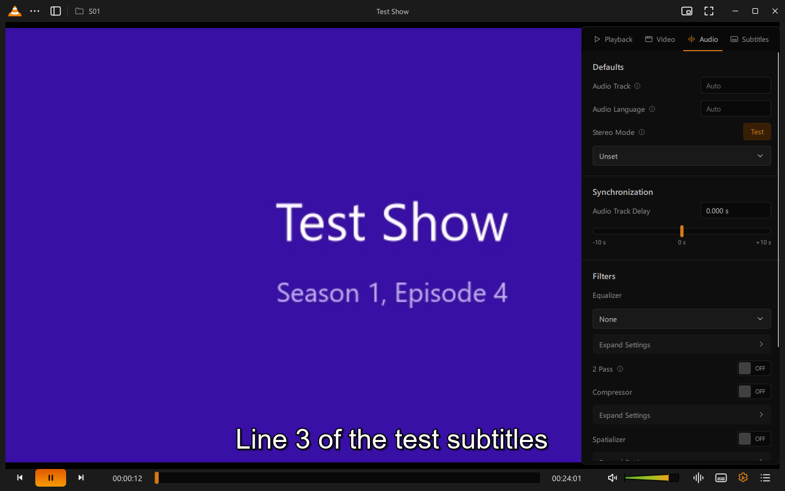
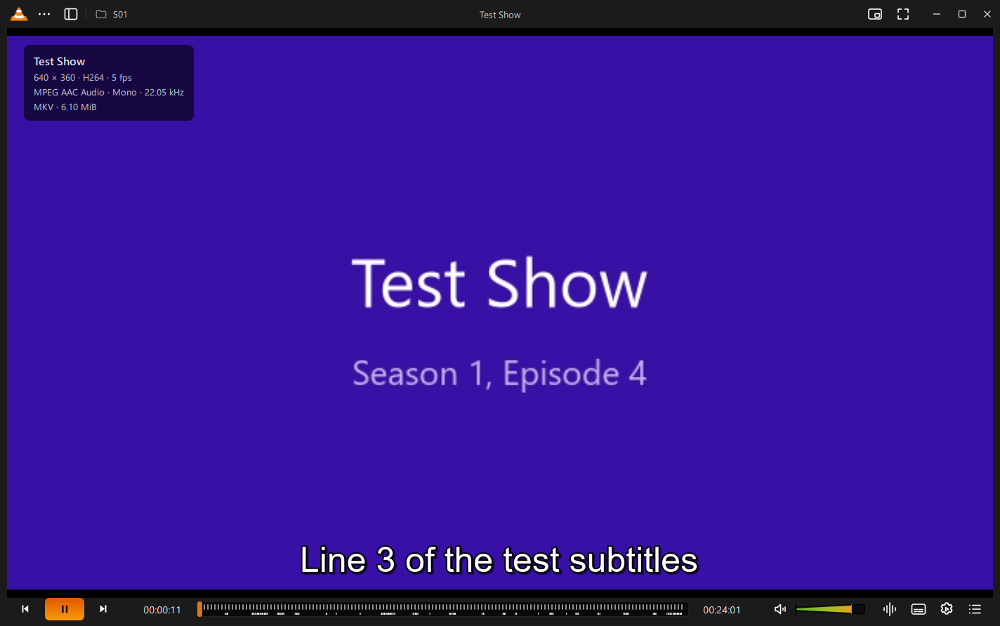
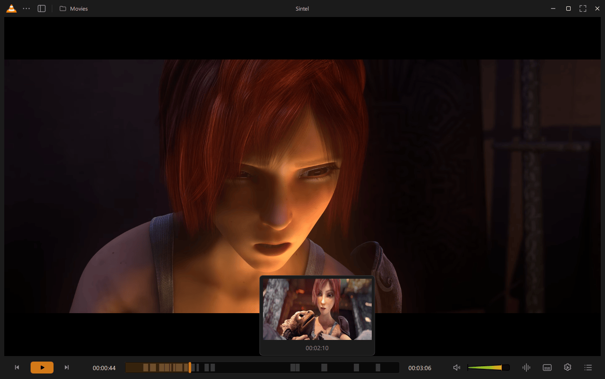
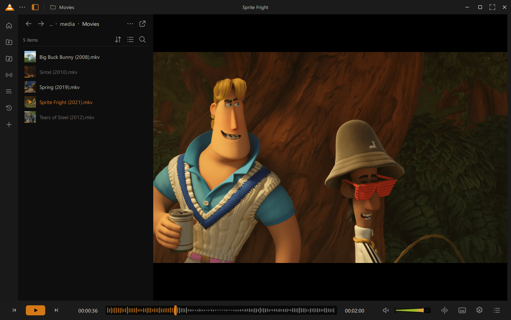
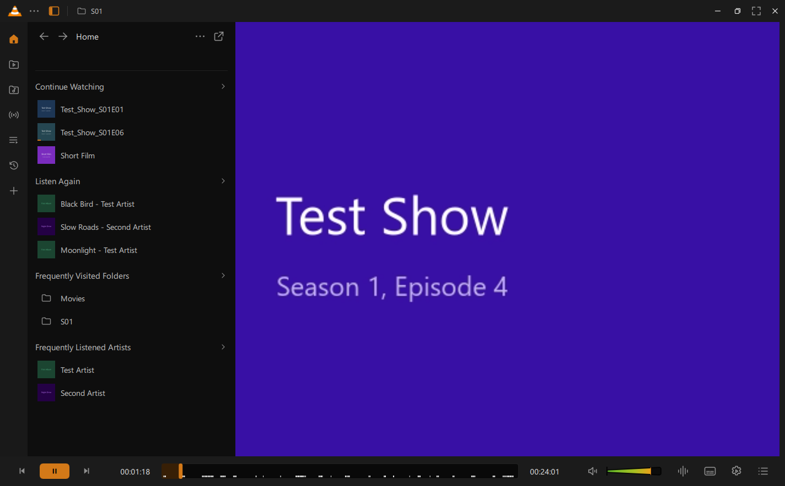
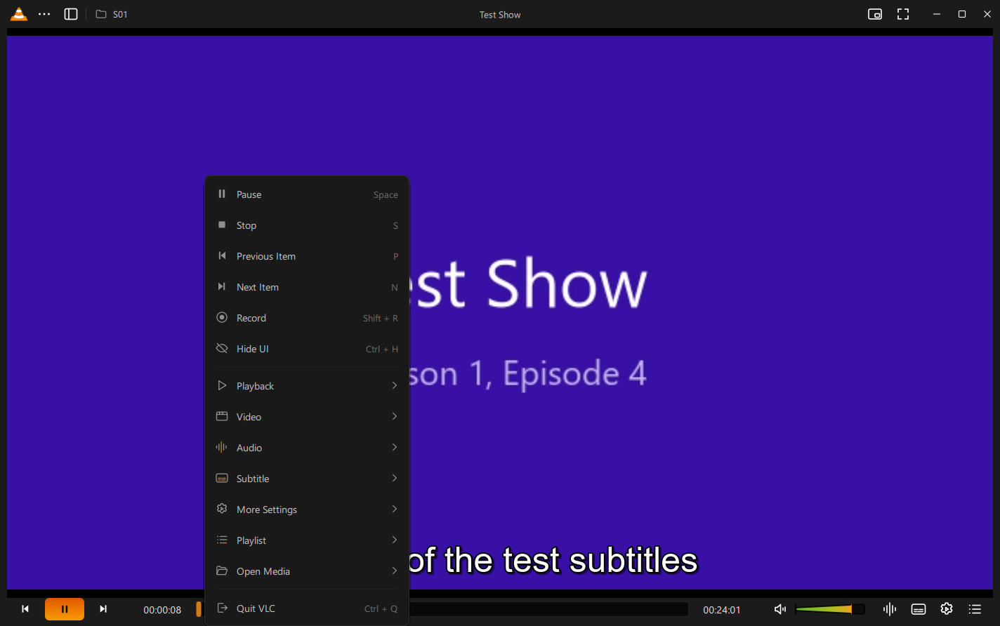

## Music

A large rounded cover over a blurred copy of it, "title - artist" under it, the
skip buttons in the control bar (their icons show the configured skip length),
and the waveform of the song in the seek bar. The waveform is the real one: the
song is decoded in the background into a small mono file, faster than it plays.

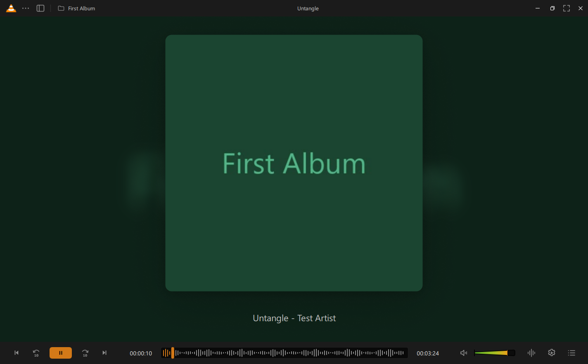

## Customize Player

The items of the design: Spacer, Divider, Playback Speed, Forward and Backward
10s and 15s, Stop, Repeat, Shuffle, Record, Snapshot, Picture in Picture, HDR,
Zoom, Right Sidebar, Quit VLC, VLC Settings, Go Home, Thumbnail, File Name,
Artist Name, Folder Name, Playlist Name, Properties, Replay, Chapters,
Favorite, Bookmark, Bookmarks and Playlists.

Both the control bar and the title bar are arranged in place: every item gets
a dashed frame and can be dragged within its bar, between the left, middle and
right groups, from the list, or onto the list to take it away. With items in
the middle of the control bar the seek bar goes on a line of its own above
them. Save keeps the arrangement in the current **profile** ("..." > Profile,
with "New" to start from a copy).

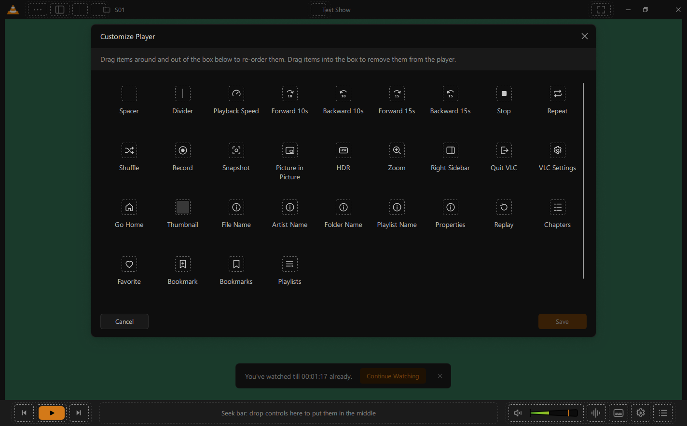

## Dialogs

- **Onboarding**: a media folder, the theme and the accent color, and the basic
  keyboard shortcuts.
- **Settings**: thirteen pages (App, Media, System) with search, the options of
  the design, advanced options folded, and the full preferences one click away.
- **Keyboard Shortcuts**: grouped, with conflicts shown and Reset All.
- **Add Subtitles**: to a file, a folder or the queue, from the computer, from
  **OpenSubtitles** or from a link. Files from the computer are matched by name
  or episode number. OpenSubtitles is searched in VLC, for the subtitles made
  for the file (by its hash) and by name, in a chosen language; a click
  downloads one next to the video. The choice is remembered for the next time
  the media plays.
- **Open Network Stream** (several links, saved as a playlist when named) and
  **New Playlist** (drop files or pick them).

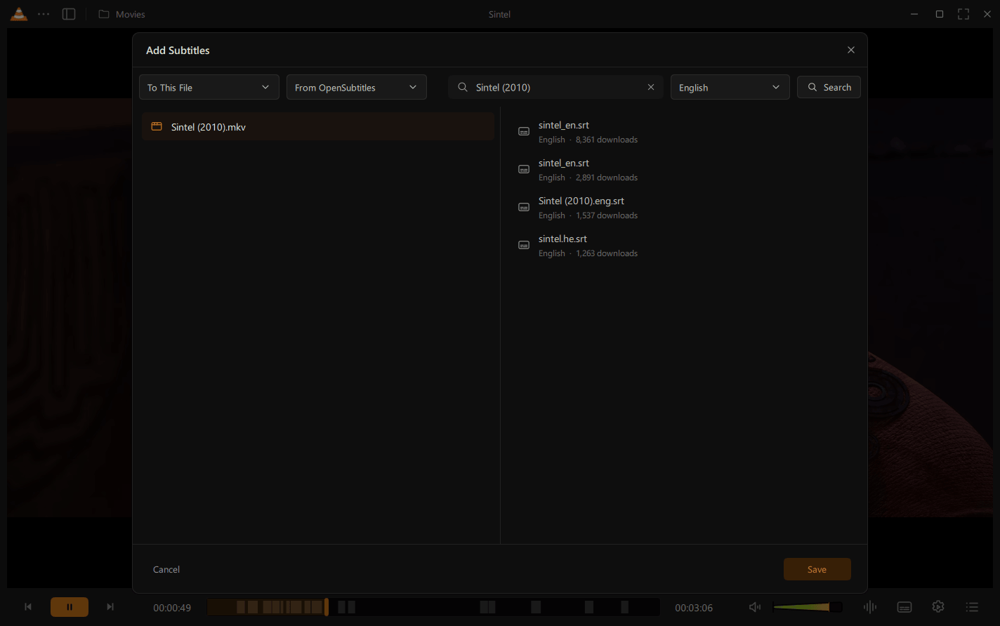
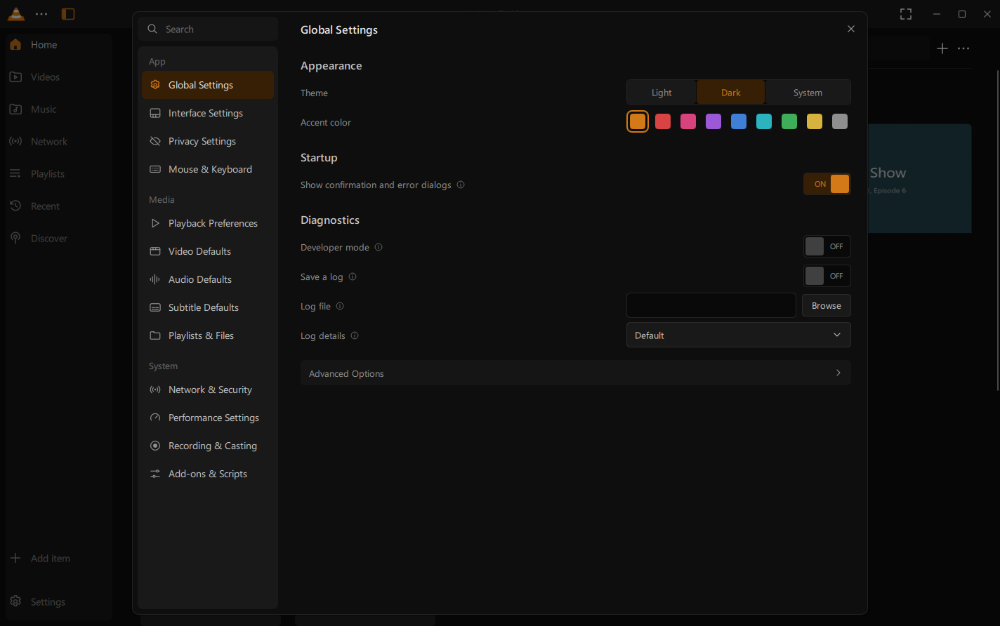

## Themes

The dark and light themes of the design, with its greys, and nine accent
colors that apply everywhere at once.

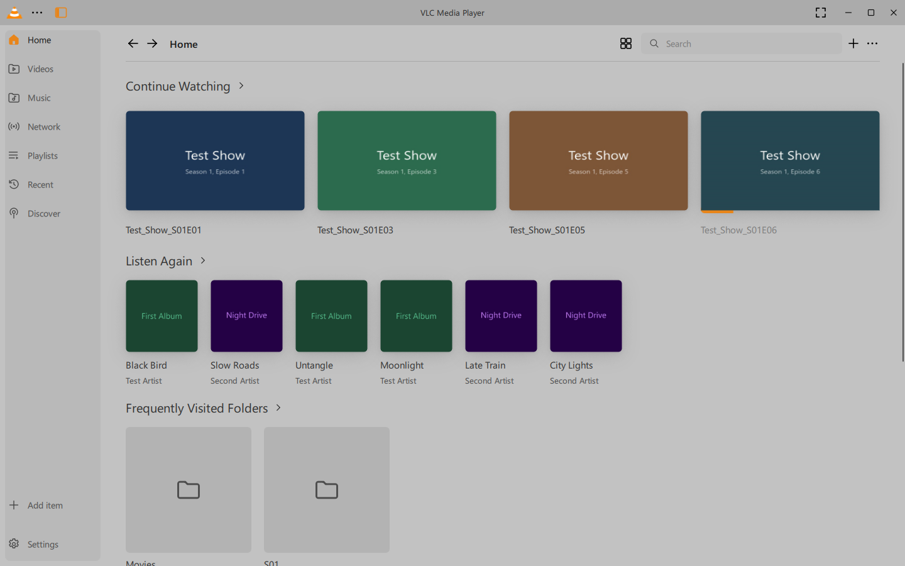

## Where it differs from the design

- The window buttons (minimize, maximize, close) stay where they are; the
  other items of the title bar move.
- The video title VLC used to print over a video as it starts is off by default,
  as the title bar shows it (Settings > Subtitle Defaults > On-Screen Messages
  brings it back).
- OpenSubtitles is searched with its REST interface (opensubtitles.org),
  which needs no account but has a daily limit.
- *Reverse* plays backwards only where VLC can (it is greyed out for media it
  cannot play backwards, such as most MKV files).
- Developed and tested on Windows only.

## Fixes found along the way

- Writing a stream to a file stopped at the first empty block, so converting or
  saving some media gave an empty file (`modules/access_output/file.c`).
- The volume on-screen display was never flushed (`src/player/osd.c`).
- `VLC_LIBEXEC_PATH` dropped the file name on Windows, so `vlc-preparser.exe`
  could not be started from a custom location (`src/win32/dirs-common.c`).
- The Qt plugin did not link `winmm`, needed by disc ejection, and the GnuTLS
  plugin did not link the socket libraries on Windows, with Meson
  (`modules/gui/qt/meson.build`, `modules/misc/meson.build`).
- A new video surface reported its position before it had a size, so the
  video showed for a moment at the corner of the window when switching
  between the player and the library (`modules/gui/qt/maininterface/videosurface.cpp`).
- Turning off a video filter that had changed the format of the pictures
  (Sepia, Old Movie... with hardware decoding) froze the picture: the display
  kept the format of the filter (`src/video_output/video_output.c`).
- VLC crashed on every exit on Windows: the media library destroys its logger
  (from the media library plugin) when the process exits, after the plugin
  was unloaded (`modules/misc/medialibrary/medialibrary.cpp`).

Also new outside the interface: on-screen messages caused by a keyboard
shortcut show the key (`--osd-show-key`), and the FreeType text renderer
applies font, colors, outline and a size in pixels (`--freetype-fontsize`)
while the video plays.

## Building

Build VLC as usual. This branch was developed with Meson on Windows (MSYS2
UCRT64, GCC 16, Qt 6.11). With MSYS2's shared libraries rather than VLC's
contribs:

- VLC's DirectComposition compositor needs Qt's `QRhi::implementation()`, which
  VLC adds with `contrib/src/qt/0001-Expose-QRhiImplementation-in-QRhi.patch`;
  apply the same change to the installed `rhi/qrhi.h`, and provide
  `D3D12MemAlloc.h` on the include path.
- VLC loads plugins with `LOAD_LIBRARY_SEARCH_SYSTEM32` only, so with shared
  libraries the plugins' dependencies (Qt, FFmpeg, GnuTLS...) must be loaded
  before them, in `vlc.exe` and in `vlc-preparser.exe` (which reads files for the
  media library, the playlist and the thumbnails).
- OpenSubtitles needs a TLS plugin (`-Dgnutls=enabled`).

## License

Same as VLC: see [COPYING](COPYING) and [COPYING.LIB](COPYING.LIB).
